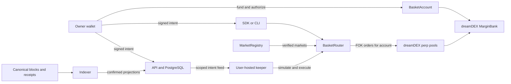

# Architecture: one decision, one transaction

The public MVP opened a BTC long and an ETH short in one transaction, then closed both in a second transaction. The account ended with no positions and no margin. The [validation record](VALIDATION.md) links those transactions and separates the public result from local and fork testing.

SpreadLock implements that execution rule as a reusable contract. A strategy chooses the positions. The owner signs their limits. A designated executor pays gas. The router commits the basket only after every required check succeeds.

## Where authority lives

The chain determines execution. PostgreSQL stores requests, sessions, jobs and projections of chain history; a database status cannot make a trade happen or reverse one. The diagram includes the implemented service path. The public MVP used the direct SDK/contract path, with receipt verification; the complete service path has been exercised locally against a mock external protocol.

## Contract responsibilities

| Component | Responsibility |
| --- | --- |
| [`MarketRegistry`](../contracts/src/MarketRegistry.sol) | Check factory origin, bank registration, common collateral and supported market metadata; control market activation and entry pause. |
| [`BasketAccountFactory`](../contracts/src/BasketAccountFactory.sol) | Create deterministic accounts with immutable owners and record factory membership. |
| [`BasketAccount`](../contracts/src/BasketAccount.sol) | Hold a basket's collateral relationship with MarginBank, grant router permissions and expose owner-controlled withdrawal, cancellation and emergency reduction. |
| [`BasketRouter`](../contracts/src/BasketRouter.sol) | Validate the signed decision, place FOK orders, verify immediate and final position changes, check fees and post-trade health, then advance the account revision. |
| [`SpreadLockGovernor`](../contracts/src/SpreadLockGovernor.sol) | Provide the production governance configuration: an initial 48-hour timelock delay with a multisig checked as 2-of-3 at construction. This configuration is not claimed as deployed production governance. |

Each basket has its own account and funding. Inside that account, dreamDEX uses cross margin across its markets. This separates one basket's deposited collateral from another basket's balance; it does not turn each leg into an isolated-margin position or remove liquidation risk.

The router does not hold collateral. The account owner retains the withdrawal path. A keeper receives permission to execute a signed decision, rather than ownership of the account.

## What the owner signs

[`IntentTypes.sol`](../contracts/src/IntentTypes.sol) defines the contract schema. The [domain package](../packages/domain/src/intent.ts) implements the corresponding EIP-712 representation.

The domain binds the chain and router. The intent binds the basket account, executor, nonce, account epoch, expected revision, expected position hash, validity window, operation, leg quantities, price limits, fee caps, combined quote bound, optional mark trigger and post-trade health requirements.

A positive leg delta buys; a negative delta sells. OPEN accepts two to eight unique markets and requires a flat starting account. ADJUST and CLOSE accept one to eight legs. CLOSE must reduce existing positions without flipping them. The account may finish with no more than eight active markets.

The position hash covers the sorted union of active and requested markets, including zero positions for new markets. A signature for an earlier account state cannot be treated as a fresh instruction after that state changes.

## Execution and rollback

The router checks authorization and starting state, validates the market grid and signed bounds, then submits FOK orders through dreamDEX. It checks each immediate delta and the complete final position set. A callback that changes an earlier leg or introduces an unsigned market must also be rejected. Fees observed for the conservative quote must remain consistent after execution.

Only after those checks and the post-trade health check pass does the account revision advance and `IntentExecuted` emit. Any revert unwinds the transaction's position changes, nonce consumption and revision update. Gas consumed by a reverted transaction remains payable.

`minNetQuote` bounds synthetic sell notional minus buy notional minus trading fees. Per-lot rounding makes the bound conservative under fragmented fills. It is not realized PnL, a collateral transfer, a hedge ratio or a funding-inclusive return. Mark triggers are a separate calculation.

## Service reliability

The [API](../apps/api/src) authenticates owners with SIWE and serves keeper sessions scoped by signed authorization. SQL leases serialize job ownership; expired or replaced workers cannot write stale observations. HTTP cancellation remains a request until the relevant invalidation is canonical.

The [keeper](../apps/keeper/src) checks its local deployment manifest, account state, scope and signature before simulation. It persists signed transaction bytes in a SQLite outbox before broadcast, tracks replacements and reserves a gas budget. A narrow FOK fallback may retry simulation once at the owner's existing signed limits; it recomputes the quote bound and never widens those limits.

The [indexer](../apps/indexer/src) validates headers, log ordering and successful receipts before projecting execution. Execution identity includes chain, transaction and intent, so several intents in one transaction remain distinct. Reorg rollback restores projections within its recovery window; a deeper reorg raises an incident and stops entry readiness. Canonical discovery and pending-confirmation indexes keep historical logs from being rescanned or rewritten unnecessarily.

Current service readiness also checks head lag, timestamp lag, checkpoint freshness and protocol fingerprints. The receipt-only public demo did not disable those production-path checks. Its narrower proof boundary is documented in [Validation](VALIDATION.md).
